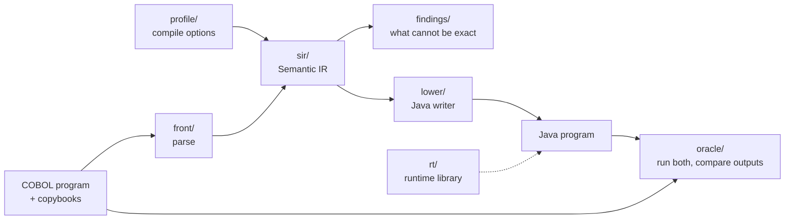

# Architecture: the modules and their jobs

> Describes Katana at commit `843076771d751f4013dbd72a41cd3cf96796566c` of its source repository,
> 2026-11-20. This page stays at the level of what each module is for.

Katana is built like a compiler: a front end reads the COBOL, an intermediate representation records
exactly what the program does, and a back end writes Java that runs on a small runtime library. A
separate module runs the original and the Java and compares what they write. The modules, what each
takes and gives, and what each may depend on are listed in `docs/modules.json`, and a test fails if
the source imports anything that file does not allow.

## The modules

| Module | Its job |
| --- | --- |
| `front/` | Parses COBOL and its copybooks, with COPY and REPLACE resolved, and maps everything back to file, line and column. Its grammars are forked from ProLeap's open-source ANTLR grammars. It knows nothing of what COBOL means. |
| `profile/` | The compile options a result is valid for: compiler and version, IBM's TRUNC, ARITH, NUMPROC, code page and others, and the matching GnuCOBOL flags. Each profile is identified by a SHA-256 hash of its contents, and that hash is recorded in everything built under it. |
| `sir/` | The Semantic IR: what the program does, derived mechanically from the parse and the profile with no judgement: every data item's offset, length and attributes, the paragraphs and how control moves between them, every statement, every file. Its contract is `docs/SEMANTIC-IR.md`, kept equal to the code by a test. |
| `findings/` | What the program does that Katana cannot make exact, reported first, before any Java is written (the codes are in the [glossary](glossary.md#findings)). |
| `lower/` | Writes one Java class per COBOL program from the Semantic IR. It makes no decisions about COBOL's meaning: those are all in `sir/`. What it cannot write exactly it reports as a finding. |
| `rt/` | The runtime library the generated Java uses: records as bytes and fields over them, decimal arithmetic under IBM's rules, the COBOL verbs (MOVE, DISPLAY, INSPECT, STRING, ...), sequential, relative and indexed files, SORT, CALL. Pure Java with no dependencies; it ships with the converted programs. |
| `oracle/` | Runs the COBOL under GnuCOBOL and the Java on the same job and says whether their outputs agree. It never reads the code of the modules that produce the Java. It also runs the NIST suite and the GnuCOBOL testsuite. |
| Further modules | Later stages that refactor the generated Java. They are not described in this public set. |
| `project/` | The workflow from a COBOL source to its Java on disk: choose the profile, parse with the copybook folders, build, convert, write, compile against the runtime, run. Used by the `katana` command, and by the test suites, so both take the same path. |
| `cli/` | The `katana` command: reads what was typed, calls `project/`, prints the report and returns the exit code ([user guide](user-guide.md#the-katana-command)). |

## Design rules that hold the layout

From `docs/modules.json`, each checked by a test (`test/ModulesTest.java`):

- **No module calls a machine-learning model.** Conversion is deterministic.
- **The runtime imports nothing,** neither Katana's own modules nor any library: it is the part that
  ships with the converted programs.
- **The Java writer decides nothing.** Every choice that depends on a COBOL property is made in the
  intermediate representation, so the writer stays simple to review.
- **The checker never reads the code it checks.** `oracle/` may not import the modules that write the
  Java.
- **The parser knows no COBOL meaning.** `front/` imports none of Katana's modules.

## The two dialects

- **GnuCOBOL 3.1.2** is the dialect supported today (`profile/gnucobol.profile`).
- **IBM Enterprise COBOL** is the goal and is in development (`profile/ibm.profile`). It is the
  code's default profile, but its results are so far compared only with GnuCOBOL's emulation of IBM,
  so IBM COBOL is not yet supported.
- The two are kept apart: GnuCOBOL's extensions are accepted only under its profile, and its results
  are never counted as IBM results. A third profile, `profile/cobol85.profile`, is used for the NIST suite.

## Around the modules

| Path | What it is |
| --- | --- |
| `test/` | The fast suite and the integration suites (`*IntegrationTest`), per module. |
| `scripts/` | The project's own tooling (the pre-push check, metrics, mutation testing); never shipped. |
| `corpus/` | The test programs (CardDemo, NIST, the GnuCOBOL testsuite), fetched, not committed. |
| `third_party/` | Vendored dependencies (ANTLR, JUnit, Gson, PIT) with their licences. |
| `Dockerfile` | The pinned image every command runs in. |
| `docs/` | The contracts, each kept equal to the code by a test, and the project's own records. |
